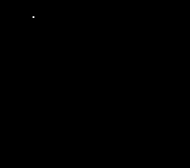

# Morphing letters for the BBC Micro

A BBC Micro demo in 6502 assembly language. It draws the outline of a letter, then morphs it smoothly into the next letter of a message, all the way through "Hello Stardot from the BBC Micro", and then loops. Every frame is redrawn from scratch at a steady 50 frames a second, in MODE 4.



The letters come from a TrueType font (DejaVu Sans Bold). They are stored as quadratic Bezier curves, the same kind of curve TrueType uses. The 6502 builds, moves and draws them live every frame.

## Running it

Load `morph.ssd` into a BBC Micro Model B emulator, or onto a real disc, and boot it with SHIFT+BREAK. It runs until you press BREAK.

> So far it has only been tested in a cycle-counting 6502 simulator. Every frame was compared byte for byte with a Python model of the program. It has not yet been run on real hardware or in an emulator, so reports are welcome.

## Building it

You need:

- [BeebAsm](https://github.com/stardot/beebasm)
- Python 3 with [fontTools](https://github.com/fonttools/fonttools) (`pip install fonttools`)
- `DejaVuSans-Bold.ttf` (on most Linux systems it is at `/usr/share/fonts/truetype/dejavu/`)

```sh
# 1. Turn the font's letters into data (writes letters.asm, letters_def.asm, letters.json)
python3 gen_letters.py DejaVuSans-Bold.ttf letters.asm letters.json "Hello Stardot from the BBC Micro" 76

# 2. Assemble a bootable disc image
beebasm -i morph.asm -do morph.ssd -boot MORPH
```

The last two arguments to `gen_letters.py` are optional. They set the message and the cap height in pixels (how tall a capital H is).

## How it works

The work is split between a PC, which does the slow and clever parts once, and the BBC Micro, which does only what has to happen live.

**On the PC (`gen_letters.py`)**

- It reads each letter from the font and scales it.
  - Straight edges become quadratic curves.
  - Neighbouring curves are merged where one curve stays within half a pixel of the original.
  - Long curves are split so the 6502's numbers stay in range.
- It stores each different letter once, in half-pixel bytes.
- For each change of letter, it writes a small **pairing plan**. The plan tells the 6502 how to line up the two outlines point for point:
  - The loops are paired up. A hole with no partner shrinks to a point, or grows out of one.
  - One loop is run backwards if the two go round in opposite directions.
  - Segments are split at stored 8-bit t values, so that both outlines have the same number of segments.
  - The start of one loop is rotated so the morph doesn't twist.
- It centres the letters on the screen. Then it runs the whole animation through `morphmodel.py`, an exact copy of the 6502's arithmetic, to find the box each transition draws in. The 6502 clears only that box.

**On the BBC Micro (`morph.asm`)**

- At the start of each morph, during a pause, it builds both outlines from the letter data and the plan. This includes de Casteljau curve splitting in 16-bit fixed point.
- Each frame, it moves every control point one eased step. Four step sizes are worked out in advance, so easing in and out costs no more than a linear morph.
- Each curve is flattened into 1, 2, 4, 8 or 16 straight pieces, chosen from how much the curve bends. Midpoint subdivision gives 2 or 4 pieces, and forward differencing gives 8 or 16. Segments that stay straight throughout the morph are found once and drawn as a single line.
- Lines are drawn with Bresenham's algorithm. There are twelve loops, one for each direction, plus plain vertical and horizontal ones. Each loop is unrolled to two pixels per pass and uses an 8-bit error term biased by 128. The screen pointer carries over from one line to the next.
- The screen is double-buffered at &3000 and &5000. The program swaps them by writing the CRTC start address and polling vertical sync, with interrupts off. A self-modifying routine clears only the box that was drawn in, at 5 cycles a byte.
- The CRTC is set to 32 columns, which gives a 256 × 256 screen, as Elite does. Each character row is then exactly 256 bytes. Stepping to the row above or below changes only the high byte of the address, and each screen takes 8K.

The source is commented in detail. The header of `morph.asm` explains the screen layout, fixed point, Bezier curves, the maths of flattening and forward differencing, Bresenham's algorithm, and the speed tricks, and each routine has its own notes.

## Performance

These figures come from the simulator, over two full cycles of the message at a cap height of 76 px:

| | |
|---|---|
| Average frame | 11.4 ms |
| Worst frame (the o → m morph) | 19.1 ms, inside the 20 ms budget |
| Clearing the drawn box | 1–3 ms a frame |
| One cycle of the message | about 26 s |

Letters 80 px tall also fit, but with only 0.1 ms to spare in the worst frame.

## Files

| File | What it is |
|---|---|
| `morph.asm` | The 6502 program (BeebAsm) |
| `gen_letters.py` | Makes the letter data, plans and screen layout from a font |
| `morphmodel.py` | An exact Python model of the 6502's arithmetic, used by `gen_letters.py` and for testing |
| `letters.asm`, `letters_def.asm` | Generated data and constants, included by `morph.asm` |
| `letters.json` | The same data for testing tools |
| `morph.ssd` | A ready-built disc image |
| `morph_preview.gif` | One cycle of the animation, rendered from the model |

## Memory map

| Address | Use |
|---|---|
| &0000–&008F | Zero page variables |
| &0400–&07FF, &0900–&0B3F | Working arrays (BASIC and OS buffer space) |
| &0E00–&18FF | Letter and plan data, copied down at start |
| &1900–&2FFF | Code |
| &3000–&4FFF | Screen 0 |
| &5000–&6FFF | Screen 1 |
| &7000–&7FFF | Free |

## Changing the message

Any message works within these limits, which `gen_letters.py` and BeebAsm check:

- each letter has at most three loops;
- each outline has at most 64 points;
- the letter and plan data fit in &B00 bytes;
- every frame fits in 20 ms. Larger letters take longer to draw, so check the timing if you go above 76 px.

Letters are drawn one at a time in the middle of the screen. Spaces in the message become longer pauses at the end of each word.

The timings are set near the top of `gen_letters.py`:

- `HOLD` and `HOLD_SPACE` set how long each letter stays on screen;
- `TRACE_FRAMES` sets how long the first letter takes to draw;
- `EASE` sets the morph's speed curve.

## Credits

The letter shapes are derived from DejaVu Sans Bold. DejaVu fonts are released under a free licence based on the Bitstream Vera licence.
